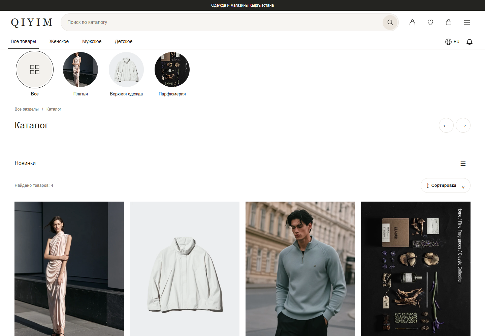

# Qiyim

Qiyim is a fashion marketplace for Kyrgyzstan. Shoppers can search local stores’ catalogs, filter clothing by category, and compare products priced in Kyrgyz som. Sellers can prepare listings, translate product copy, and submit items for review. [Visit Qiyim](https://qiyim.kg/)

## AI features I built

- **Catalog photography.** A seller selects a garment photo and a model. A Supabase function validates the request, submits it to fal.ai’s FLUX Virtual Try-On queue, and records the job ID so the seller can retrieve the result. The generated image stays private until the seller chooses to submit it for review.
- **Product translation.** I integrated the OpenAI Responses API to translate product titles and descriptions. Sellers can review the generated copy while preparing a listing.
- **Sales analysis.** The backend calculates delivered revenue, average order value, and sales by product before asking the OpenAI Responses API to summarize the figures. This keeps the model’s explanation grounded in the seller’s recorded orders.

## How I evaluated the work

For a windbreaker, I compared generated photos with the original garment and checked the collar, front placket, and pockets. I rejected a FASHN v1.6 sample because it altered those details. A convincing fashion photo still has to depict the item a shopper will receive.

During the September 13, 2026 release check, 304 tests passed in the root project and 36 in the mobile project. The Android, iOS, and web exports also completed.

## Stack

React and Vite for the storefront, Expo and React Native for mobile, and TypeScript, Supabase Edge Functions, and PostgreSQL for backend services.

